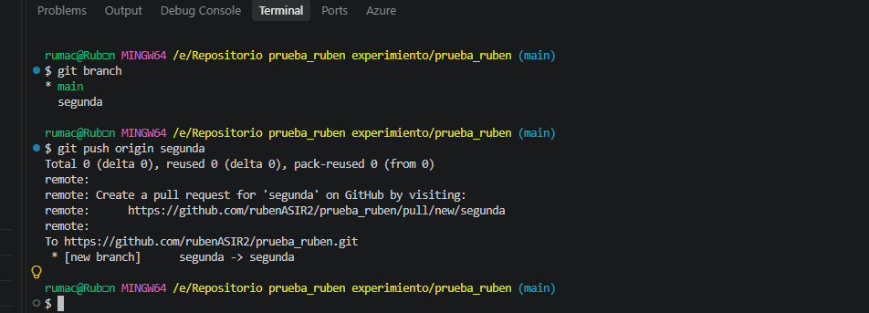
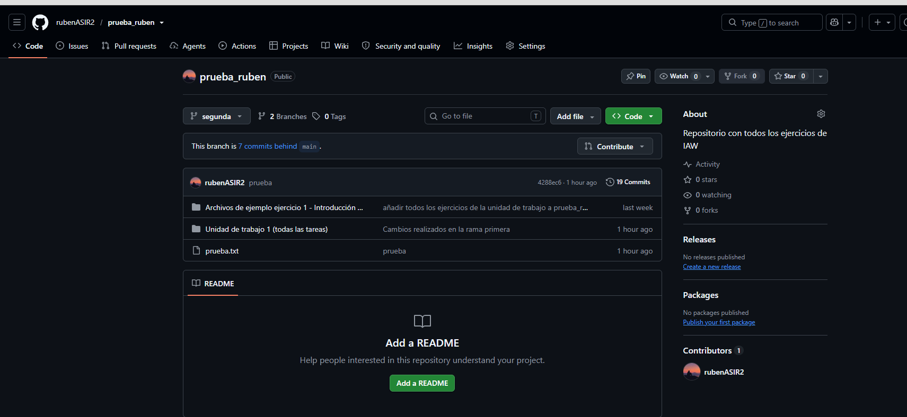

# Ejercicio 3 - Trabajo con ramas en Git

En este ejercicio se trabajó con el repositorio utilizado en los ejercicios anteriores. El objetivo principal fue aprender a crear ramas, realizar cambios de forma independiente, subirlas a GitHub y posteriormente fusionarlas con la rama principal.

## 1. Comprobación de las ramas existentes

### En primer lugar, se accedió al repositorio local y se comprobaron las ramas disponibles mediante el comando:


* git branch


### El resultado mostró la rama principal main, marcada con un asterisco, indicando que era la rama en la que se estaba trabajando actualmente.

* main

* 

### La rama main es la rama principal del proyecto y contiene el estado principal del repositorio.

## 2. Creación de una nueva rama

### A continuación, se creó una nueva rama llamada primera utilizando:

* git branch primera

### Después, se volvieron a listar las ramas para comprobar que la nueva rama se había creado correctamente:

* git branch

### El resultado fue similar al siguiente:

* main
  primera

* 

### El asterisco continuaba apareciendo en main, por lo que todavía se estaba trabajando en la rama principal.

## 3. Cambio a la rama primera

### Para comenzar a trabajar en la nueva rama, se utilizó:

* git checkout primera

### Después se comprobó nuevamente la rama en la que se estaba trabajando:

* git branch

### El resultado fue:

* main
* primera


### Esto confirmó que el trabajo se estaba realizando ahora en la rama primera.

### Al cambiar a esta rama, se pudo comprobar que inicialmente contenía los mismos ficheros que la rama principal.

### También se utilizó el comando:

* git branch -v

### Este comando permite consultar el último commit de cada rama. Al principio, el último commit de main y primera coincidía, ya que la nueva rama se había creado a partir de la rama principal.

## 4. Realización de cambios en la rama primera

### Una vez dentro de la rama primera, se modificó uno de los ficheros existentes y se creó un nuevo fichero.

### Después, se añadieron los cambios al área de preparación:

* git add .

### A continuación, se realizó un commit:

* git commit -m "Cambios realizados en la rama primera"

### Para comprobar el estado de las ramas, se ejecutó:

* git branch -v

### El último commit de la rama primera era diferente al de main, ya que los cambios realizados todavía no se habían incorporado a la rama principal.

### También se comprobó que al volver a main los cambios realizados en primera no aparecían en esta rama:

* git checkout main

### Esto permitió comprobar que las ramas funcionan como líneas independientes de desarrollo.
 
 
 


## 5. Fusión de la rama primera con main

### Una vez realizados los cambios, se procedió a unir la rama primera con la rama principal.

### Primero, se volvió a la rama main:

* git checkout main

### Después, se realizó la fusión:

* git merge primera

### En este caso, no se produjo ningún conflicto, ya que los cambios realizados en la rama primera no modificaban la misma parte de un fichero que hubiese sido modificada en main.


### Los cambios se pudieron fusionar automáticamente y los nuevos ficheros y modificaciones pasaron a formar parte de la rama principal.

## Eliminación de la rama primera

Una vez fusionados los cambios con la rama principal, eliminé la rama
primera mediante el siguiente comando:

```bash
git branch -d primera
```

## 6. Creación de un conflicto

### Para comprobar cómo funcionan los conflictos, se realizó una segunda prueba.

### Primero, se creó un fichero llamado prueba.txt en la rama principal:

* git checkout main


### Después de crear el fichero, se añadieron los cambios y se realizó un commit:

* git add prueba.txt
*git commit -m "Creación del fichero prueba.txt"


### A continuación, se creó una nueva rama llamada segunda:

* git branch segunda
* git checkout segunda


### En esta rama se modificó el contenido de prueba.txt y se realizó un commit:

* git add prueba.txt
* git commit -m "Modificación de prueba.txt en segunda"


### Después, se volvió a la rama principal:

* git checkout main


### En main se volvió a modificar la misma parte del fichero prueba.txt y se realizó otro commit:

* git add prueba.txt
* git commit -m "Modificación de prueba.txt en main"


### Finalmente, se intentó fusionar la rama segunda con main:

* git merge segunda


### En este momento Git detectó un conflicto porque se había modificado la misma parte del fichero en las dos ramas.

## 7. Contenido del fichero con el conflicto

* Al producirse el conflicto, el fichero prueba.txt mostraba unas marcas similares a las siguientes:

<<<<<<< HEAD
Contenido modificado en la rama principal
=======
Contenido modificado en la rama segunda
>>>>>>> segunda

La parte situada entre <<<<<<< HEAD y ======= corresponde a los cambios realizados en la rama main.

La parte situada entre ======= y >>>>>>> segunda corresponde a los cambios realizados en la rama segunda.

Estas marcas son añadidas automáticamente por Git para indicar las dos versiones que están entrando en conflicto.

.png)

## 8. Solución del conflicto

### Para solucionar el conflicto, se abrió el fichero prueba.txt y se decidió qué contenido debía mantenerse.

### Después de editar el fichero, se eliminaron las marcas:

<<<<<<< HEAD
=======
>>>>>>> segunda


### Una vez solucionado el conflicto, se añadió el fichero:

* git add prueba.txt

### Después, se realizó el commit correspondiente:

* git commit -m "Solución del conflicto en prueba.txt"

* .png)

### De esta manera, el conflicto quedó solucionado y las dos ramas pudieron quedar fusionadas correctamente.

## 9. Subida de la rama segunda a GitHub

### Finalmente, se subió la rama segunda al repositorio remoto de GitHub utilizando:

* git push origin segunda
* 

### Con este comando, la rama segunda quedó creada también en GitHub.




## Conclusión

**Con este ejercicio se pudo comprobar cómo funcionan las ramas en Git. Se creó una rama independiente, se realizaron cambios en ella y posteriormente se fusionó con la rama principal.**

**También se comprobó que los cambios realizados en una rama no afectan a la rama principal hasta que se realiza una fusión.**

**Por último, se provocó un conflicto modificando la misma parte de un fichero en dos ramas diferentes. Git detectó el conflicto y fue necesario modificar manualmente el fichero para solucionarlo antes de completar la fusión.**